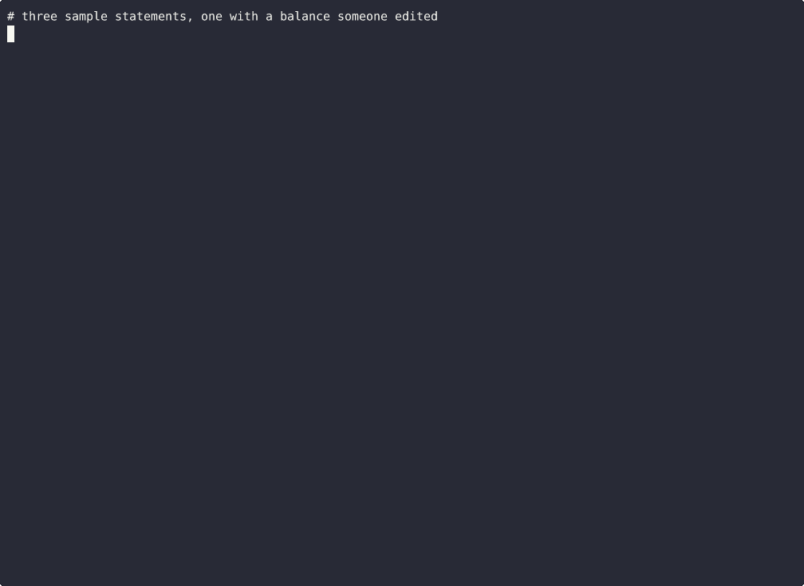

# statementrows



Bank and credit card statement PDFs to Excel. Every row is checked against the statement's own numbers, so you know it's right before you use it.

```
statementrows statements/ --out excel/
```

## Why the checking matters

Most converters give you a spreadsheet and leave you to find out later that a row went missing or a minus sign flipped. A statement already prints the answer: a running balance on every row, an opening and closing balance, and usually totals. This reads the rows, then checks them against all of that.

- Each balance has to follow from the one above it, to the cent.
- Opening balance plus the rows has to equal the closing balance.
- Printed totals like "8 Deposits/Credits 3,782.09" have to match, both the amount and the count.
- Every date has to fall inside the statement period.

If something doesn't add up, the file is marked `unbalanced` and the row is named. Nothing gets quietly fixed or guessed. On a real bank's sample that turned out to be page 1 of 5, it said "7 debit row(s) are missing, often a page left out of the PDF", which was true.

## What you get

For each PDF:

- `.xlsx` with a Transactions sheet (rows that broke are shaded) and a Check sheet saying what was checked and what didn't add up.
- `.csv` and `.json` with the same rows.

Plus `summary.csv` with one line per statement.

Columns: date, description, amount (money in positive, money out negative), direction, balance, check, account, page, a second date when the bank prints two, a note, and ref (cheque numbers and the like).

## What it handles

Separate debit and credit columns, or one amount column with `-`, `( )`, a trailing minus or CR/DR. Dates with or without the year, day first or month first, month names in English, French, Dutch, Spanish and German. Descriptions on two or three lines, above or below the date. Statements with several accounts, including credit union statements with savings, checking, certificates and loans on one PDF. Statements with no running balance that split rows into "Deposits and other additions" and "Withdrawals and other subtractions" sections, where the heading decides the sign. Check lists with two or three checks to a line. A balance printed only once a day. Credit card statements.

A scanned statement (a picture, no text) comes back as `needs_ocr`. A password protected one comes back as `encrypted`. Neither is guessed at. `--ocr` tries to read scans anyway. It's experimental and slow, and any number it misreads breaks the balance on that row, so you see exactly which rows to look at (results in ACCURACY.md).

## Your statements stay with you

It runs on your computer. Nothing is uploaded and no copy of the PDF is made. It only writes the files you asked for into the folder you named.

## Tests

`./check.sh` runs 50 tests (4 of them use sample statements that can't be shared, and skip when those are missing): statements built to break it (a wrong balance, a missing row, an impossible date, every sign style), plus sample statements from outside sources with published answer files. `ACCURACY.md` has the full record, including what it got wrong the first time it saw each one.

Sample statements in `corpus/` are synthetic, from the Bankstatemently benchmark (MIT), AyonPal's parser repo (MIT), Synthesized (CC BY 4.0) and AgamiAI (Apache 2.0).
